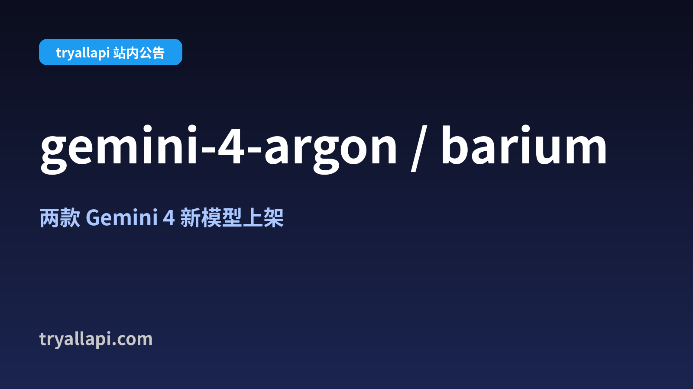
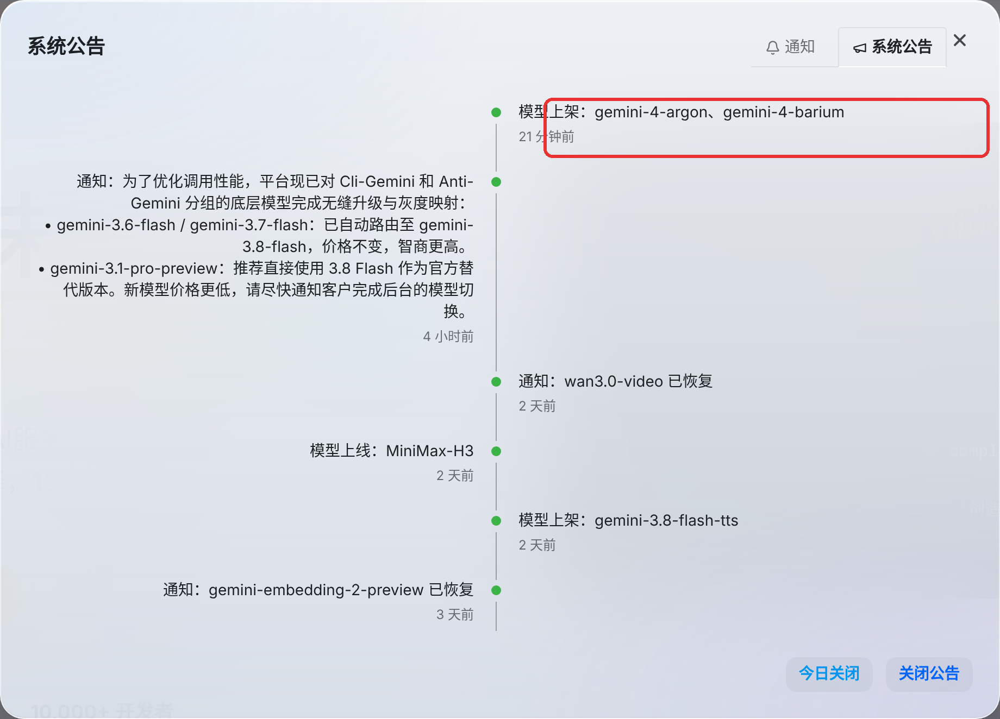
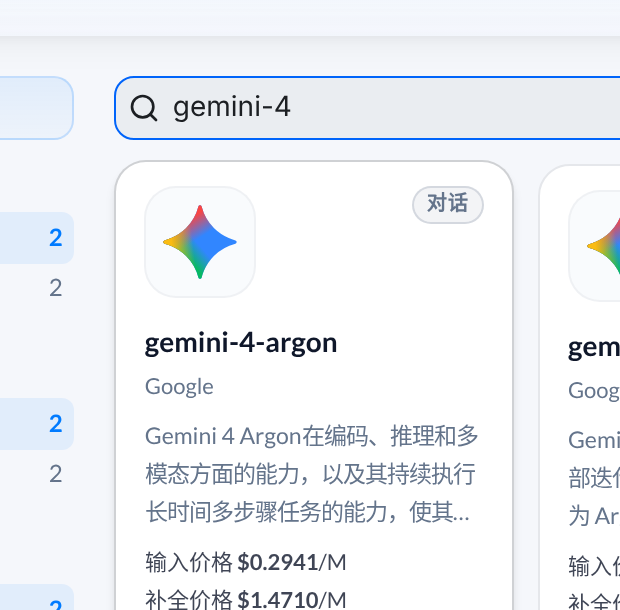
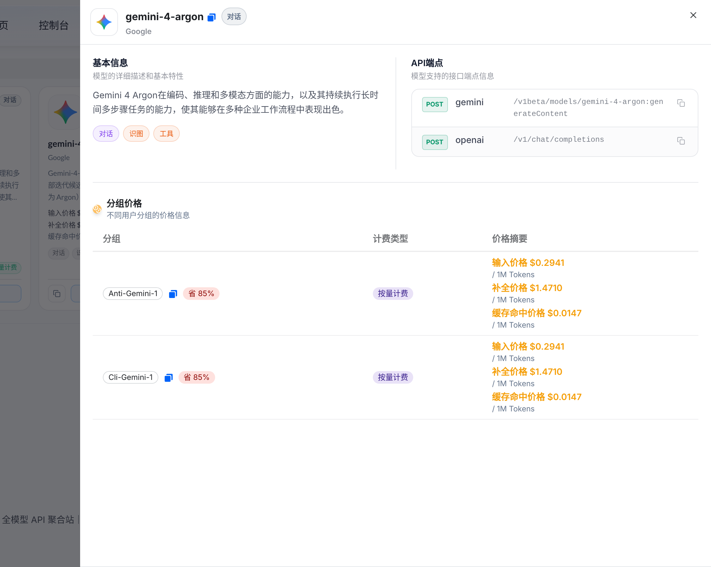
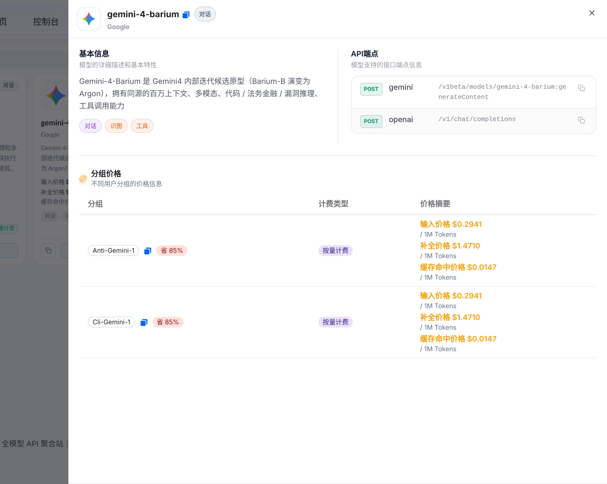
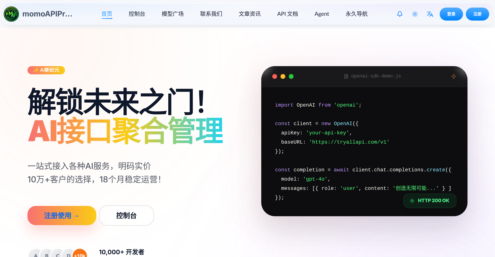

# Gemini 4 双子星：gemini-4-argon & gemini-4-barium 调用指南（tryallapi）

> **gemini-4-argon** 和 **gemini-4-barium** 已在 [tryallapi](https://tryallapi.com/) 上架，OpenAI 兼容接口 / Gemini 原生接口均可调用，一个 Key 直接用。
>
> 原文（CSDN）：[Gemini 4 双子星上架：gemini-4-argon 和 gemini-4-barium，tryallapi 今天就能调](https://blog.csdn.net/xianyu120/article/details/167808730)

English: [README.en.md](./README.en.md)



## 目录

- [上架消息](#上架消息)
- [这俩模型是什么？](#这俩模型是什么)
- [价格：两个一个价](#价格两个一个价)
- [适合拿来干嘛？](#适合拿来干嘛)
- [在 tryallapi 怎么调？](#在-tryallapi-怎么调)
- [快速上手](#快速上手)
- [相关链接](#相关链接)

## 上架消息

2026 年 10 月 13 日下午，tryallapi 站内公告：**模型上架：gemini-4-argon、gemini-4-barium**。



## 这俩模型是什么？

> [!NOTE]
> 以下介绍**全部来自 tryallapi 模型广场的站内描述**，未做跑分，不代表性能评测。具体效果请自行上手测试；上下文长度等具体参数**以站内说明为准**。

| 模型 | 站内描述 |
| --- | --- |
| `gemini-4-argon` | “在编码、推理和多模态方面的能力，以及其持续执行长时间多步骤任务的能力，使其能够在多种企业工作流程中表现出色” |
| `gemini-4-barium` | “Gemini4 内部迭代候选原型（Barium-B 演变为 Argon）”；“百万上下文、多模态、代码 / 法务金融 / 漏洞推理、工具调用能力” |

- 站内标签（两者相同）：**对话 / 识图 / 工具**
- 供应商归类：**Google**



## 价格：两个一个价

截图时间 2026-10-13，最终以页面为准：

| 模型 | 输入 | 补全（输出） | 缓存命中 | 可用分组 |
| --- | --- | --- | --- | --- |
| `gemini-4-argon` | $0.2941 / 1M Tokens | $1.4710 / 1M Tokens | $0.0147 / 1M Tokens | Anti-Gemini-1、Cli-Gemini-1 |
| `gemini-4-barium` | $0.2941 / 1M Tokens | $1.4710 / 1M Tokens | $0.0147 / 1M Tokens | Anti-Gemini-1、Cli-Gemini-1 |

- 两个分组倍率均为 **x0.1471**，按量计费，详情页标注“省 85%”
- 站点首页写明：充值 **$1 起**，**余额不过期**

<details>
<summary>📸 模型详情页截图（端点与分组价格）</summary>





</details>

## 适合拿来干嘛？

按站内描述，比较对口的场景：

- **写代码、改代码、多步骤 Agent 任务**（argon 描述中专门提到“长时间多步骤任务”）
- **带图片的问答**（标签含“识图”）
- **Function Calling / 工具调用**类业务（标签含“工具”）

建议：两个模型用同一批 prompt 各跑一遍，价格一样，哪个顺手用哪个。

## 在 tryallapi 怎么调？

详情页显示支持两种端点：

| 格式 | 端点 |
| --- | --- |
| OpenAI | `POST /v1/chat/completions` |
| Gemini | `POST /v1beta/models/{model}:generateContent` |

- `base_url`：`https://tryallapi.com/v1`（站点首页示例）
- 令牌分组：选择 **Anti-Gemini-1** 或 **Cli-Gemini-1**



### curl（OpenAI 兼容）

```bash
curl https://tryallapi.com/v1/chat/completions \
  -H "Authorization: Bearer $TRYALLAPI_KEY" \
  -H "Content-Type: application/json" \
  -d '{
    "model": "gemini-4-argon",
    "messages": [{"role": "user", "content": "用三句话解释什么是 RAG"}]
  }'
```

### Python（openai SDK）

```python
from openai import OpenAI

client = OpenAI(api_key="你的 tryallapi 令牌", base_url="https://tryallapi.com/v1")

resp = client.chat.completions.create(
    model="gemini-4-barium",  # 或 gemini-4-argon
    messages=[{"role": "user", "content": "帮我 review 一下这段 Python 代码……"}],
)
print(resp.choices[0].message.content)
```

### Gemini 原生格式

```bash
curl "https://tryallapi.com/v1beta/models/gemini-4-argon:generateContent" \
  -H "Authorization: Bearer $TRYALLAPI_KEY" \
  -H "Content-Type: application/json" \
  -d '{"contents":[{"parts":[{"text":"你好，介绍一下你自己"}]}]}'
```

> [!TIP]
> - 鉴权头的写法以站内 API 文档为准。
> - 站内 Google 供应商说明提到：部分模型支持在模型名后加 `-thinking` / `-nothinking` 区分思考模式；这两款是否支持，以站内说明为准。

## 快速上手

1. 注册：👉 [https://tryallapi.com/register?aff=5A6A](https://tryallapi.com/register?aff=5A6A)
2. 充值
3. 创建令牌（选对分组：Anti-Gemini-1 / Cli-Gemini-1）
4. 把 `model` 改成 `gemini-4-argon` 或 `gemini-4-barium`

新模型刚上架最适合尝鲜，花几毛钱就能跑一轮对比。用下来什么感受，欢迎在 [Issues](../../issues) 或 [CSDN 原文](https://blog.csdn.net/xianyu120/article/details/167808730) 评论区交流～

## 相关链接

- tryallapi：<https://tryallapi.com/>
- TryGPT：<https://trygpt.asia/>
- CSDN 原文：<https://blog.csdn.net/xianyu120/article/details/167808730>

---

> 免责声明：本仓库内容整理自 tryallapi 站内公告与模型广场描述（2026-10-13），价格、参数、可用分组等随时可能调整，一切以官网页面为准。
